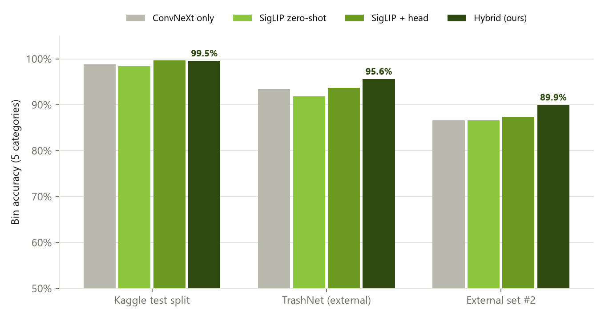
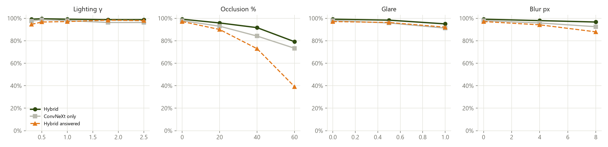

# Binzy - Smart Waste Segregation Assistant: Project Report

**Event:** VIT AI Innovate-A-Thon, Question 6  
**Deliverable:** working web app (camera, upload, live scan) backed by a hybrid computer-vision recogniser

## 1. Problem and intended users
A campus cafeteria generates mixed waste (paper, plastic, metal, food scraps, non-recyclables). Items in the wrong bin contaminate recycling and increase manual sorting. Binzy classifies a photo of one waste item into one of five disposal categories, names the item, shows the target bin and disposal steps, and - when it is unsure or the image is not waste - asks the user to check the label, retake the photo or ask staff.

Users: students/faculty at the bin (phone or kiosk camera); cafeteria staff and the sustainability team.

## 2. Categories
| Category | Bin | Dataset classes |
|---|---|---|
| Paper & Cardboard | Blue Bin - Dry Paper Recyclables | Cardboard, Paper |
| Plastic | Yellow Bin - Recyclable Plastics | Plastic |
| Metal | Grey Bin - Metals & Cans | Metal |
| Food Scraps / Organic | Green Bin - Wet / Compostable Food Waste | Food / Biological |
| Non-Recyclable / Special Waste | Red/Black Bin or Special-Handling Point | Battery, Brown Glass, Clothes / Textile, Green Glass, Shoes, General Trash, Clear Glass |

Glass, batteries, textiles and shoes are grouped as Non-Recyclable / Special Waste because the brief defines five categories, but each gets its own instruction (glass crate, e-waste box, donation).

## 3. Data and documented split
Training data: Garbage Classification, 12 classes (Mostafa Abla, Kaggle; Hugging Face mirror `UdaraChamidu/Garbage-Classification-with-12-classes`), 15,520 images, stratified 70/15/15 split with seed 42 (`train.py`, file list in `artifacts/split.csv`).

| Class | Category | Train | Val | Test | Total |
|---|---|---|---|---|---|
| Battery | Non-Recyclable / Special Waste | 661 | 142 | 142 | 945 |
| Food / Biological | Food Scraps / Organic | 690 | 148 | 147 | 985 |
| Brown Glass | Non-Recyclable / Special Waste | 425 | 91 | 91 | 607 |
| Cardboard | Paper & Cardboard | 624 | 134 | 133 | 891 |
| Clothes / Textile | Non-Recyclable / Special Waste | 3728 | 798 | 799 | 5325 |
| Green Glass | Non-Recyclable / Special Waste | 440 | 94 | 95 | 629 |
| Metal | Metal | 538 | 115 | 116 | 769 |
| Paper | Paper & Cardboard | 735 | 158 | 157 | 1050 |
| Plastic | Plastic | 605 | 130 | 130 | 865 |
| Shoes | Non-Recyclable / Special Waste | 1384 | 296 | 297 | 1977 |
| General Trash | Non-Recyclable / Special Waste | 488 | 105 | 104 | 697 |
| Clear Glass | Non-Recyclable / Special Waste | 546 | 117 | 117 | 780 |
| **Total** | | **10864** | **2328** | **2328** | **15520** |

External data (never used for training):
- **TrashNet** (Stanford, 2,527 photos, 6 classes) - used to tune fusion weights, reported as a tuning set.
- **External set #2** (`dmedhi/garbage-image-classification-detection`, validation split, 397 photos) - held out.
- **Imagenette** validation (1,000 everyday non-waste photos) - out-of-scope test.
- **Synthetic patterns** (noise, blank tray, checkerboard, gradients) - out-of-scope test.

## 4. Method
Three experts produce probabilities over the 12 classes:
1. **SigLIP-so400m zero-shot** (Google, `google/siglip-so400m-patch14-384`): image vs. text embeddings of 202 vocabulary entries (≈200 described waste items, each mapped to a class, plus ≈50 'not waste' concepts), three prompt templates each. Gives open-vocabulary recognition and an explicit 'not waste' probability.
2. **SigLIP linear head**: logistic regression (C=5) on SigLIP image embeddings of the training split (validation accuracy 99.27%).
3. **ConvNeXt-Tiny**: ImageNet-pretrained, fully fine-tuned for 5 epochs (AdamW, one-cycle LR, mixed precision, class-weighted loss, ColorJitter + RandomErasing), best epoch 5 by validation macro-F1.

**Fusion:** p = 0.5·zero-shot + 0.1·head + 0.4·ConvNeXt (temperature 2.0), chosen by grid search to maximise mean bin accuracy on Kaggle validation + TrashNet. Class probabilities are summed into the 5 bins.

**Safety gate:** out of scope if the zero-shot 'not waste' mass > 0.30; 'not sure' if the top bin probability < 0.52 or the normalised entropy over the 5 bins > 0.66. Thresholds are the 97th / 3rd percentiles on in-scope tuning photos - no out-of-scope data was used to set them.

ConvNeXt training log:

| Epoch | Train loss | Val accuracy | Val macro-F1 |
|---|---|---|---|
| 1 | 0.7547 | 0.9596 | 0.9436 |
| 2 | 0.1704 | 0.9635 | 0.9509 |
| 3 | 0.0851 | 0.9764 | 0.9693 |
| 4 | 0.0338 | 0.9807 | 0.9772 |
| 5 | 0.0284 | 0.9815 | 0.9778 |

## 5. Results
### Bin accuracy on photos the models never trained on

| Dataset | n | ConvNeXt only | SigLIP zero-shot | SigLIP head | **Hybrid** | Hybrid macro-F1 | Answered | Acc. when answered |
|---|---|---|---|---|---|---|---|---|
| Kaggle test split | 2328 | 98.8% | 98.4% | 99.7% | **99.5%** | 98.9% | 97.2% | 99.9% |
| TrashNet (external) (tuning) | 2527 | 93.4% | 91.8% | 93.7% | **95.6%** | 95.5% | 93.0% | 97.4% |
| External set #2 | 397 | 86.6% | 86.6% | 87.4% | **89.9%** | 89.9% | 91.2% | 92.3% |

Out-of-scope: 93.0% of 1,000 Imagenette photos were refused (71.8% as 'not waste', the rest as 'not sure'); synthetic patterns: 100.0% refused. ConvNeXt alone with the old MSP/entropy gate flagged 68.7% of Imagenette.



### ConvNeXt detail on the Kaggle test split (2,328 images)
| Metric | 5 bins | 12 classes |
|---|---|---|
| Accuracy | 98.80% | 98.07% |
| Macro F1 | 97.22% | 97.57% |

| Class | Precision | Recall | F1 | n |
|---|---|---|---|---|
| Battery | 0.979 | 1.000 | 0.990 | 142 |
| Food / Biological | 0.986 | 0.986 | 0.986 | 147 |
| Brown Glass | 1.000 | 0.978 | 0.989 | 91 |
| Cardboard | 0.992 | 0.977 | 0.985 | 133 |
| Clothes / Textile | 0.996 | 0.989 | 0.992 | 799 |
| Green Glass | 0.989 | 0.979 | 0.984 | 95 |
| Metal | 0.948 | 0.948 | 0.948 | 116 |
| Paper | 0.968 | 0.975 | 0.971 | 157 |
| Plastic | 0.960 | 0.923 | 0.941 | 130 |
| Shoes | 0.967 | 0.990 | 0.978 | 297 |
| General Trash | 0.972 | 1.000 | 0.986 | 104 |
| Clear Glass | 0.950 | 0.966 | 0.958 | 117 |


### Failure cases (most confident ConvNeXt test mistakes)
| True | Predicted | Confidence | Same bin |
|---|---|---|---|
| Plastic | Clear Glass | 99.9% | no |
| Clothes / Textile | Shoes | 99.6% | yes |
| Paper | Metal | 99.5% | no |
| Clothes / Textile | Shoes | 99.3% | yes |
| Clear Glass | Metal | 99.3% | no |
| Plastic | Food / Biological | 99.3% | no |
| Shoes | Clothes / Textile | 97.6% | yes |
| Brown Glass | Metal | 97.3% | no |
| Cardboard | Paper | 97.2% | yes |
| Clear Glass | Plastic | 97.0% | no |

Typical confusions: clear glass vs. plastic (transparent, similar shapes), paper vs. cardboard (same bin), trash vs. plastic packaging. Real-world photos from the team (chocolate wrapper, leftover cake) were misjudged by ConvNeXt alone and corrected by the open-vocabulary experts.

## 6. Lighting and occlusion
Hybrid vs. ConvNeXt on 240 test images (20 per class) with the app's perturbations:

**Lighting gamma**

| Value | Hybrid acc. | ConvNeXt acc. | Hybrid answered | Hybrid acc. when answered |
|---|---|---|---|---|
| 0.3 | 99.2% | 97.5% | 94.6% | 99.6% |
| 0.5 | 99.6% | 98.8% | 96.7% | 99.6% |
| 1.0 | 99.2% | 97.9% | 97.1% | 99.6% |
| 1.8 | 98.8% | 96.2% | 98.3% | 99.2% |
| 2.5 | 98.8% | 96.2% | 97.9% | 99.6% |

**Occlusion %**

| Value | Hybrid acc. | ConvNeXt acc. | Hybrid answered | Hybrid acc. when answered |
|---|---|---|---|---|
| 0 | 99.2% | 97.9% | 97.1% | 99.6% |
| 20 | 95.8% | 92.9% | 90.0% | 100.0% |
| 40 | 91.7% | 84.2% | 72.9% | 100.0% |
| 60 | 79.2% | 73.3% | 39.2% | 100.0% |

**Glare**

| Value | Hybrid acc. | ConvNeXt acc. | Hybrid answered | Hybrid acc. when answered |
|---|---|---|---|---|
| 0.0 | 99.2% | 97.9% | 97.1% | 99.6% |
| 0.5 | 98.3% | 95.8% | 96.2% | 99.6% |
| 1.0 | 95.0% | 91.2% | 92.1% | 98.6% |

**Blur radius**

| Value | Hybrid acc. | ConvNeXt acc. | Hybrid answered | Hybrid acc. when answered |
|---|---|---|---|---|
| 0 | 99.2% | 97.9% | 97.1% | 99.6% |
| 4 | 97.9% | 95.8% | 94.2% | 99.1% |
| 8 | 96.7% | 92.5% | 87.9% | 98.1% |



Discussion: dim light removes colour and texture cues; overexposure and glare wash out white paper, clear plastic and glass so they look alike; central occlusion hides the object so the models fall back on edges and background. Lighting is handled well thanks to ColorJitter training and SigLIP's broad pre-training; heavy occlusion (>40%) is the main weakness. As images degrade the gate answers fewer of them, so accuracy on answered photos stays higher than raw accuracy. Mitigations: augmentation (done), the gate with retake / check-label prompts (done), a diffused LED ring light and fixed camera at the bin (proposed), multi-frame voting in live mode (proposed).

## 7. Responsible AI
- **Privacy:** photos are processed in memory on the local machine and discarded; nothing is written to disk or sent to a cloud service. Session statistics are counts only.
- **Bias / domain shift:** training photos are mostly clean single items from outside India. The open-vocabulary list adds Indian cafeteria items, but accuracy in a real cafeteria will be lower than the test scores.
- **Human oversight:** uncertain or out-of-scope photos never receive a bin decision; users check the label, ask staff or choose the bin. Hazardous items (batteries, broken glass) always go to staff.
- **Accessibility:** icons plus text, plain-language steps, large touch targets, works in a phone browser, dark mode.
- **Security:** uploads limited to 15 MB, decoded only as images (decompression-bomb guard), model checkpoint loaded with `weights_only=True`, server binds to localhost unless `--lan` is passed.

## 8. SDG alignment
SDG 12.5 (substantially reduce waste through recycling), SDG 11.6 (municipal / campus waste management), SDG 13 (food waste to compost/biogas instead of landfill reduces methane).

## 9. Implemented vs. future work
**Implemented:** hybrid recogniser, open vocabulary, camera / upload / live scan web app, item-specific instructions, out-of-scope and uncertainty gate with manual override, documented split, external-dataset evaluation, robustness study and live stress test.

**Future:** local VIT cafeteria dataset and fine-tuning, multi-item tray detection (YOLO + TACO), edge deployment at the bin, contamination dashboard, regional-language labels and voice prompts.

## 10. How to run
```
run_app.bat               (opens http://localhost:8000)
run_app.bat --lan         (also reachable from a phone on the same Wi-Fi)
```
Reproduce: `train.py` → `evaluate.py` → `build_hybrid.py` → `generate_demo_samples.py` → `build_deliverables.py`.